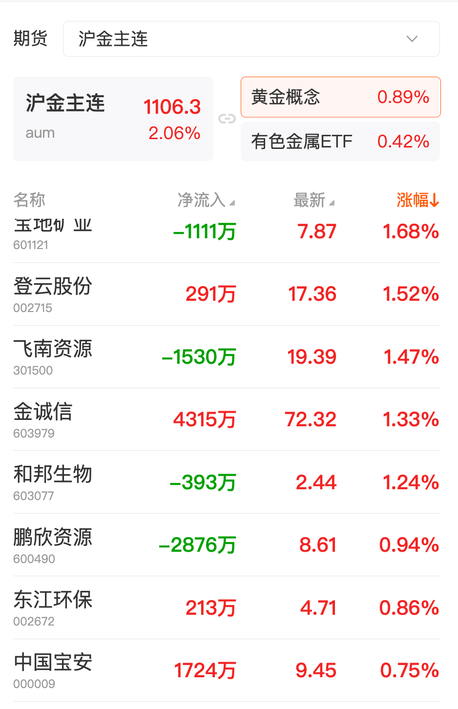
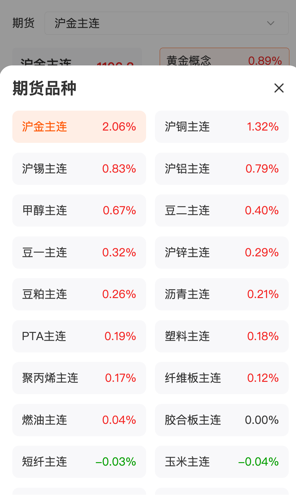

# 期货联动
## [期货关联股票及ETF模块](我wohttps://emcfgdata.eastmoney.com/api/futuresLink/getFuturesLinks)
payload = {
    args: {
        "industryNodeName": "锡"  //为空查全部期货关联股票 按板块查询关联的期货股票
    },
    client: android,  # 客户端类型标识，这里表示请求来自 Android 手机端
    randomCode: 1687681190127168768219012363456et375d8f,  # 随机码，用于防缓存或防重复请求，通常每次请求生成不同值
    timestamp: 1770396919730,  # 时间戳（毫秒），表示请求发送的时间，接口可能用它验证请求时效
    clientType: cfw,  # 客户端子类型，cfw 可能代表“期货客户端”或特定功能模块
    clientVersion: 10.14  # 客户端版本号，用于接口判断功能或返回兼容数据
}

### 股票详情
[获取指定股票详情](https://push2delay.eastmoney.com/api/qt/ulist.np/get?ut=c38fe8f6b4af4bd6683d94ff21883db4&fltt=2&invt=2&fields=f14%2Cf148%2Cf3%2Cf12%2Cf2%2Cf13%2Cf62&secids=1.603876,1.600219,1.600361,0.300057,1.603937,0.300337,1.601388,1.601600,1.600595,1.601702,1.600888,0.003038,0.002160,0.002501,0.002532,0.000612,0.000807,0.000933,0.002379,1.605208,0.002988,1.601677,0.002578,1.603271,1.603115,0.002824,0.002806,0.002540,0.300328,1.600768,0.300986,0.300828,0.002996,1.603993,1.600111,1.601600,0.000807,1.600362,0.000426,0.000630,1.601168,1.600549,0.002532,1.688795,1.688802,1.600930,1.688783,0.301656,1.560860,113.aum,113.snm,113.cum,113.alm,115.MAM,113.znm,114.bm,114.am,114.mm,113.bum,115.TAM,114.lm,114.ppm,114.fbm,113.fum,114.bbm,115.PFM,114.cm,113.pbm,113.rum,115.URM,115.CYM,114.pgm,142.lum,114.egm,113.ssm,114.vm,115.SMM,114.im,115.SFM,113.hcm,114.lhm,113.rbm,115.FGM,115.SAM,114.jmm,114.jm,225.sim,225.lcm&)
域名 push2delay.eastmoney.com：通常属于东方财富的 延迟行情/实时行情推送接口
路径 /api/qt/ulist.np/get：请求 批量股票数据（股票列表）
{
  "fields": "f14,f148,f3,f12,f2,f13,f62",
  "fltt": "2",
  "invt": "2",
  "secids": "1.603876,1.600219,1.600361,0.300057,1.603937,0.300337,1.601388,1.601600,1.600595,1.601702,1.600888,0.003038,0.002160,0.002501,0.002532,0.000612,0.000807,0.000933,0.002379,1.605208,0.002988,1.601677,0.002578,1.603271,1.603115,0.002824,0.002806,0.002540,0.300328,1.600768,0.300986,0.300828,0.002996,1.603993,1.600111,1.601600,0.000807,1.600362,0.000426,0.000630,1.601168,1.600549,0.002532,1.688795,1.688802,1.600930,1.688783,0.301656,1.560860,113.aum,113.snm,113.cum,113.alm,115.MAM,113.znm,114.bm,114.am,114.mm,113.bum,115.TAM,114.lm,114.ppm,114.fbm,113.fum,114.bbm,115.PFM,114.cm,113.pbm,113.rum,115.URM,115.CYM,114.pgm,142.lum,114.egm,113.ssm,114.vm,115.SMM,114.im,115.SFM,113.hcm,114.lhm,113.rbm,115.FGM,115.SAM,114.jmm,114.jm,225.sim,225.lcm",
  "ut": "c38fe8f6b4af4bd6683d94ff21883db4"
}

### 期货关联ETF的股票集合
[东方财富 · ETF 持仓股票查询接口](https://datacenter.eastmoney.com/securities/api/data/v1/get?reportName=RPT_ETF_POSITION&columns=FUCODE,SECUCODE,SECURITY_NAME_ABBR,SECURITY_CODE,NETASSET_RATIO&quoteColumns=&filter=(FUCODE="")&pageNumber=&pageSize=&sortTypes=-1&sortColumns=NETASSET_RATIO&source=SECURITIES&client=APP&)
[东方财富 · 指定ETF持仓股票查询接口](https://datacenter.eastmoney.com/securities/api/data/v1/get?reportName=RPT_ETF_POSITION&columns=FUCODE,SECUCODE,SECURITY_NAME_ABBR,SECURITY_CODE,NETASSET_RATIO&quoteColumns=&filter=(FUCODE=%22560860.SH%22)&pageNumber=&pageSize=&sortTypes=-1&sortColumns=NETASSET_RATIO&source=SECURITIES&client=APP&)

### columns 字段说明

| 字段名 | 含义 |
|--------|------|
| FUCODE | 基金/ETF 产品内码（标识 ETF） |
| SECUCODE | 标的证券内部唯一标识 |
| SECURITY_NAME_ABBR | 标的证券简称 |
| SECURITY_CODE | 标的证券代码（如 600000.SH） |
| NETASSET_RATIO | 持仓占净值比例（该标的在 ETF 净资产中的权重） |

### filter 参数说明

| 参数 | 含义 |
|------|------|
| FUCODE="" | ETF 产品代码为空（需填写具体 ETF 代码才能获取持仓数据） |

### 排序参数说明

| 参数 | 含义 |
|------|------|
| sortColumns | NETASSET_RATIO（按持仓占比排序） |
| sortTypes | -1（降序，即占比大的排在前面） |

### URL 参数说明

| 参数名 | 解释 |
|--------|------|
| reportName | RPT_ETF_POSITION：ETF 持仓占比接口，用于查询 ETF 基金内标的持仓比例 |
| columns | 返回字段列表 |
| quoteColumns | 当前接口无需行情字段引用，此处为空 |
| filter | 数据筛选条件，本接口需指定 ETF 代码 |
| pageNumber | 分页页码，本例为空未指定 |
| pageSize | 每页返回数量，本例为空未指定 |
| sortTypes | 排序方式，-1 表示降序 |
| sortColumns | 排序字段 |
| source | 数据来源标识，固定为 SECURITIES |
| client | 客户端标识，固定为 APP |

{
  "client": "APP",
  "columns": "FUCODE,SECUCODE,SECURITY_NAME_ABBR,SECURITY_CODE,NETASSET_RATIO",
  "filter": "(FUCODE="")", # 为空获取所有ETF 股票集合# (FUCODE="560860.SH") 获取指定ETF 股票集合 
  "pageNumber": "",
  "pageSize": "",
  "quoteColumns": "",
  "reportName": "RPT_ETF_POSITION",
  "sortColumns": "NETASSET_RATIO",
  "sortTypes": "-1",
  "source": "SECURITIES"
}