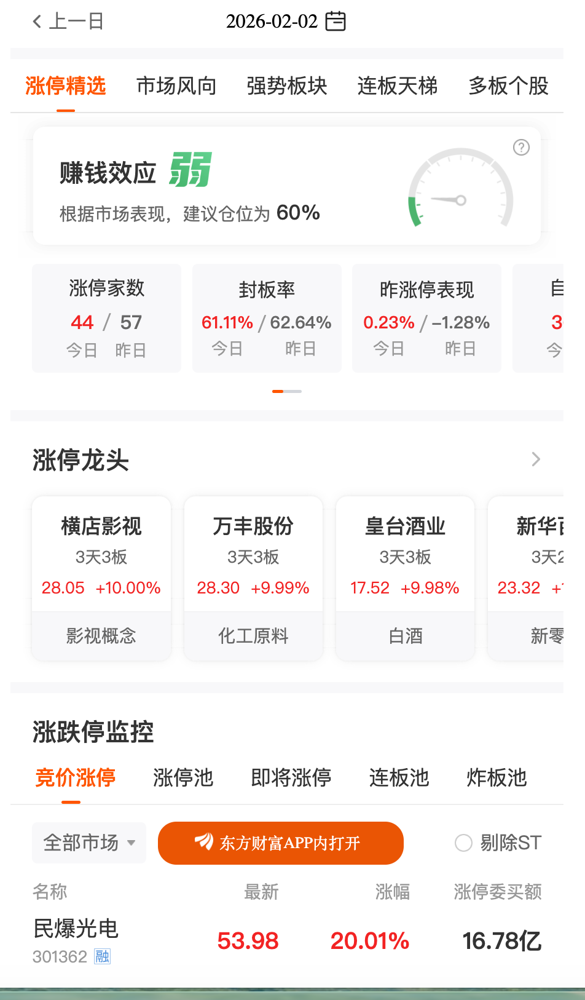
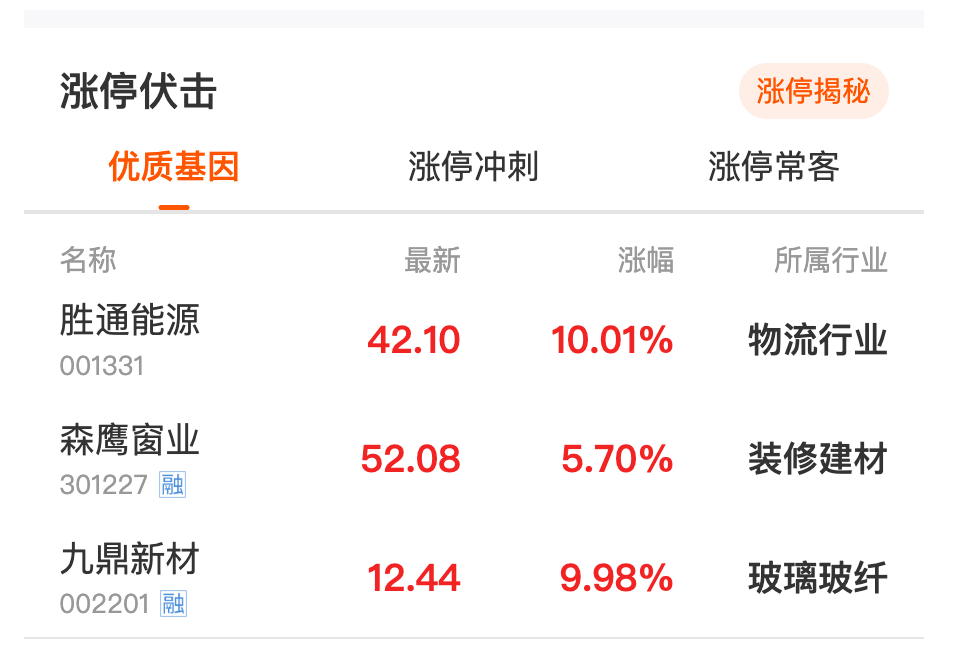
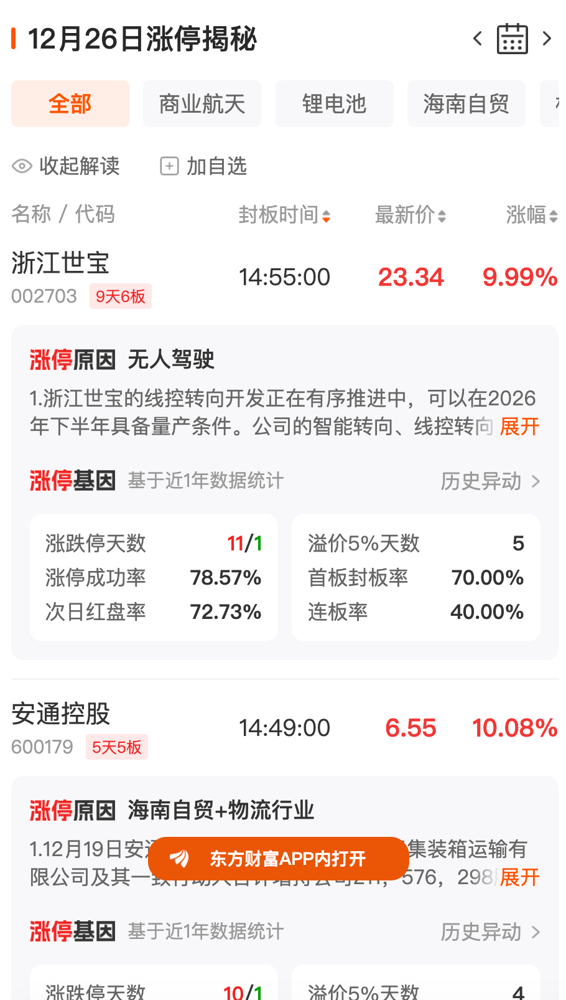
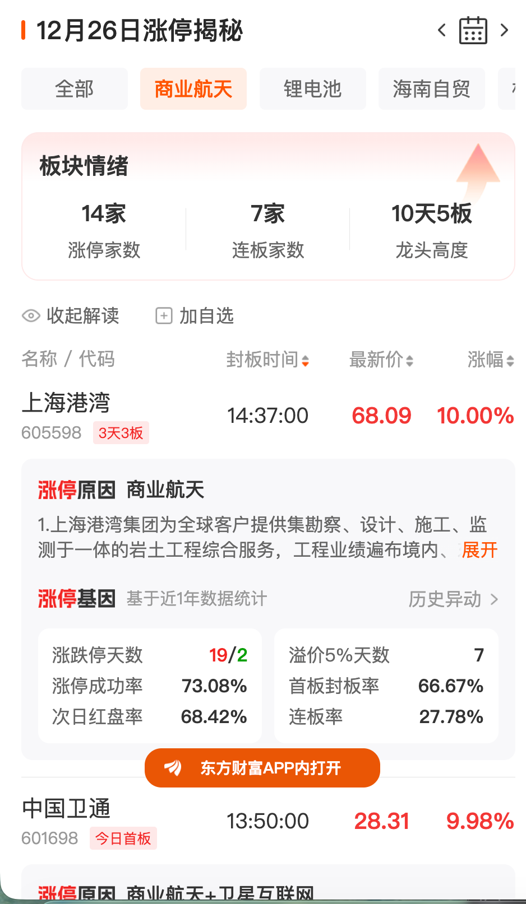

# 选择交易日期
[东方财富 · 交易日期列表接口](https://datacenter.eastmoney.com/securities/api/data/v1/get?source=SECURITIES&client=APP&reportName=RPT_INTSELECTION_DATELIST&columns=TRADE_DATE,IS_NEW&sortTypes=-1&sortColumns=TRADE_DATE&em_timestamp=1770038173111)
{
  "client": "APP",
  "columns": "TRADE_DATE,IS_NEW",
  "em_timestamp": "1770038173111",
  "reportName": "RPT_INTSELECTION_DATELIST",
  "sortColumns": "TRADE_DATE",
  "sortTypes": "-1",
  "source": "SECURITIES"
}

**Query Parameters**

| 参数名 | 示例值 | 说明 |
|------|------|------|
| source | SECURITIES | 数据来源 |
| client | APP | 客户端类型 |
| reportName | RPT_INTSELECTION_DATELIST | 报表名称 |
| columns | TRADE_DATE,IS_NEW | 返回字段 |
| sortTypes | -1 | 倒序 |
| sortColumns | TRADE_DATE | 排序字段 |
| em_timestamp | 1770038173111 | 时间戳 |

# 涨停精选
## 市场统计
涨停市场效应/涨停统计
[东方财富 · 涨停历史接口](https://datacenter.eastmoney.com/securities/api/data/v1/get?source=SECURITIES&client=APP&reportName=RPT_INTSELECTION_LIMITHIS&columns=TRADE_DATE,LIMIT_NUMBERS,NATURAL_LIMIT,DAILY_LIMIT,TOUCH_LIMIT,SEALING_RATE,NATURAL_LIMIT_YES,LIMIT_PER_YES,POSITION_SUGGESTION,MONEYMAKING_EFFECT,SEALING_RATE_YES,LIMIT_DOWN_NUM,CJDT_NUM,DT_FBL&filter=(TRADE_DATE%3C%3D%272025-12-26%27)&pageNumber=1&pageSize=2&sortTypes=-1&sortColumns=TRADE_DATE&em_timestamp=1770038173236)
{
  "client": "APP",
  "columns": "TRADE_DATE,LIMIT_NUMBERS,NATURAL_LIMIT,DAILY_LIMIT,TOUCH_LIMIT,SEALING_RATE,NATURAL_LIMIT_YES,LIMIT_PER_YES,POSITION_SUGGESTION,MONEYMAKING_EFFECT,SEALING_RATE_YES,LIMIT_DOWN_NUM,CJDT_NUM,DT_FBL",
  "em_timestamp": "1770038173236",
  "filter": "(TRADE_DATE<='2025-12-26')",
  "pageNumber": "1",
  "pageSize": "2",
  "reportName": "RPT_INTSELECTION_LIMITHIS",
  "sortColumns": "TRADE_DATE",
  "sortTypes": "-1",
  "source": "SECURITIES"
}

**columns 字段说明**

| 字段名 | 含义 |
|------|------|
| TRADE_DATE | 交易日期 |
| LIMIT_NUMBERS | 当日涨停家数 |
| NATURAL_LIMIT | 自然涨停家数（非一字板） |
| DAILY_LIMIT | 一字涨停家数 |
| TOUCH_LIMIT | 盘中触及涨停家数 |
| SEALING_RATE | 当日封板率 |
| NATURAL_LIMIT_YES | 上一交易日自然涨停家数 |
| LIMIT_PER_YES | 上一交易日涨停占比 |
| POSITION_SUGGESTION | 市场位置建议 |
| MONEYMAKING_EFFECT | 赚钱效应 |
| SEALING_RATE_YES | 上一交易日封板率 |
| LIMIT_DOWN_NUM | 跌停家数 |
| CJDT_NUM | 成交地天板数量 |
| DT_FBL | 地天板比例 |

## 连板涨停龙头
[东方财富 · 涨停个股历史接口](https://datacenter.eastmoney.com/securities/api/data/v1/get?source=SECURITIES&client=APP&reportName=RPT_INTSELECTION_LIMITSTOCKHIS&columns=SECUCODE,SECURITY_CODE,SECURITY_NAME_ABBR,BOARD_NAME,NEWEST_PRICE,YIELD,NDAYS_NLIMITE,CLOSE_LIMITUP_TIME,LIMITUP_NUM,LIMITUP_AMOUNT,TURNOVERRATE,NET_INFLOW,TRADE_DATE,ZTJY&filter=(TRADE_DATE%3D%272025-12-26%27)(IS_HOT_STOCK%3D1)&distinct=SECUCODE&pageNumber=1&pageSize=5&sortTypes=-1,-1,-1&sortColumns=NDAYS_NLIMITE_RANK,ZTJY,BOARD_YILD&em_timestamp=1770038173236)

**columns 字段说明**

| 字段名 | 含义 |
|--------|------|
| SECUCODE | 证券代码（内部唯一标识） |
| SECURITY_CODE | 标准股票代码（如 600519） |
| SECURITY_NAME_ABBR | 股票简称 |
| BOARD_NAME | 所属板块/市场名称 |
| NEWEST_PRICE | 最新价格 |
| YIELD | 涨幅（%） |
| NDAYS_NLIMITE | 连涨天数（连续涨停天数） |
| CLOSE_LIMITUP_TIME | 封单消失时间（涨停解除时间） |
| LIMITUP_NUM | 当日涨停次数 |
| LIMITUP_AMOUNT | 涨停成交金额 |
| TURNOVERRATE | 换手率 |
| NET_INFLOW | 净流入资金 |
| TRADE_DATE | 交易日期 |
| ZTJY | 涨停家数/成交激励指标 |

{
  "client": "APP",
  "columns": "SECUCODE,SECURITY_CODE,SECURITY_NAME_ABBR,BOARD_NAME,NEWEST_PRICE,YIELD,NDAYS_NLIMITE,CLOSE_LIMITUP_TIME,LIMITUP_NUM,LIMITUP_AMOUNT,TURNOVERRATE,NET_INFLOW,TRADE_DATE,ZTJY",
  "distinct": "SECUCODE",
  "em_timestamp": "1770038173236",
  "filter": "(TRADE_DATE='2025-12-26')(IS_HOT_STOCK=1)",
  "pageNumber": "1",
  "pageSize": "5",
  "reportName": "RPT_INTSELECTION_LIMITSTOCKHIS",
  "sortColumns": "NDAYS_NLIMITE_RANK,ZTJY,BOARD_YILD",
  "sortTypes": "-1,-1,-1",
  "source": "SECURITIES"
}

## 涨跌停监控
### 竞价涨停
[东方财富 · 监控异动历史接口](https://datacenter.eastmoney.com/securities/api/data/v1/get?source=SECURITIES&client=APP&reportName=RPT_INTSELECTION_MONITORHIS&columns=SECUCODE,SECURITY_CODE,SECURITY_NAME_ABBR,TRADE_DATE,NEWEST_PRICE,YIELD,MISMATCH_LIMIT_AMOUNT,MATCH_CHANGE_RATE,MATCH_DEAL_AMOUNT,MATCH_DEAL_VOLUME,MISMATCH_VOLUME,MISMATCH_AMOUNT,MISMATCH_TURNOVERRATE,BOARD_NAME,IS_MARGININFO&filter=(TRADE_DATE%3D%272025-12-26%27)(IS_MISMATCH_LIMIT%3D1)&pageNumber=1&pageSize=8&sortTypes=-1&sortColumns=MISMATCH_LIMIT_AMOUNT&em_timestamp=1770038173236)

**columns 字段说明**

| 字段名 | 含义 |
|--------|------|
| SECUCODE | 证券内部唯一标识 |
| SECURITY_CODE | 标准股票代码（如 600519） |
| SECURITY_NAME_ABBR | 股票简称 |
| TRADE_DATE | 交易日期 |
| NEWEST_PRICE | 最新价格 |
| YIELD | 涨幅/跌幅（%） |
| MISMATCH_LIMIT_AMOUNT | 异动涨停金额 |
| MATCH_CHANGE_RATE | 交投变化率 |
| MATCH_DEAL_AMOUNT | 交投成交金额 |
| MATCH_DEAL_VOLUME | 交投成交量 |
| MISMATCH_VOLUME | 异动成交量 |
| MISMATCH_AMOUNT | 异动金额 |
| MISMATCH_TURNOVERRATE | 异动换手率 |
| BOARD_NAME | 所属板块/市场名称 |
| IS_MARGININFO | 是否有融资融券信息 |

filter 参数增加了市场类型和排除 ST 股票:
"filter": "(TRADE_DATE='2025-12-26')(IS_MISMATCH_LIMIT=1)(MARKET_TYPE in ("001","002","003","004"))(IS_ST="0")",

{
  "client": "APP",
  "columns": "SECUCODE,SECURITY_CODE,SECURITY_NAME_ABBR,TRADE_DATE,NEWEST_PRICE,YIELD,MISMATCH_LIMIT_AMOUNT,MATCH_CHANGE_RATE,MATCH_DEAL_AMOUNT,MATCH_DEAL_VOLUME,MISMATCH_VOLUME,MISMATCH_AMOUNT,MISMATCH_TURNOVERRATE,BOARD_NAME,IS_MARGININFO",
  "em_timestamp": "1770038173236",
  "filter": "(TRADE_DATE='2025-12-26')(IS_MISMATCH_LIMIT=1)",
  "pageNumber": "1",
  "pageSize": "8",
  "reportName": "RPT_INTSELECTION_MONITORHIS",
  "sortColumns": "MISMATCH_LIMIT_AMOUNT",
  "sortTypes": "-1",
  "source": "SECURITIES"
}

### 涨停池
[东方财富 · 监控涨停板详细接口](https://datacenter.eastmoney.com/securities/api/data/v1/get?source=SECURITIES&client=APP&reportName=RPT_INTSELECTION_MONITORHIS&columns=SECUCODE,SECURITY_CODE,SECURITY_NAME_ABBR,TRADE_DATE,NEWEST_PRICE,YIELD,BOARD_NAME,ZTJY,TURNOVERRATE,NET_INFLOW,CLOSE_LIMITUP_TIME,LIMITUP_NUM,LIMITUP_AMOUNT,NDAYS_NLIMITE,IS_NATURAL_LIMIT,IS_DAILY_LIMIT,IS_MARGININFO&filter=(TRADE_DATE%3D%272025-12-26%27)(IS_ST%3D%220%22)(MARKET_TYPE+in+(%22001%22,%22002%22,%22003%22,%22004%22))((IS_NATURAL_LIMIT%3D1)(%7C(IS_DAILY_LIMIT%3D1)))&pageNumber=1&pageSize=8&sortTypes=-1&sortColumns=LIMITUP_AMOUNT&em_timestamp=1770044834764)

**columns 字段说明**

| 字段名 | 含义 |
|--------|------|
| SECUCODE | 证券内部唯一标识 |
| SECURITY_CODE | 标准股票代码 |
| SECURITY_NAME_ABBR | 股票简称 |
| TRADE_DATE | 交易日期 |
| NEWEST_PRICE | 最新价格 |
| YIELD | 涨幅/跌幅（%） |
| BOARD_NAME | 所属板块/市场名称 |
| ZTJY | 涨停交易指标 |
| TURNOVERRATE | 换手率 |
| NET_INFLOW | 净流入资金 |
| CLOSE_LIMITUP_TIME | 涨停解除时间 |
| LIMITUP_NUM | 当日涨停次数 |
| LIMITUP_AMOUNT | 涨停成交金额 |
| NDAYS_NLIMITE | 连续涨停天数 |
| IS_NATURAL_LIMIT | 是否自然涨停（非一字板） |
| IS_DAILY_LIMIT | 是否当日涨停 |
| IS_MARGININFO | 是否有融资融券信息 |

**filter 参数说明**

| 参数 | 含义 |
|-------|------|
| TRADE_DATE='2025-12-26' | 交易日期，表示抓取这一天的数据 |
| IS_ST="0" | 排除 ST 股票（ST 股票标记为 1） |
| MARKET_TYPE in ("001","002","003","004") | 市场类型，分别对应不同板块或交易所，例如沪市、深市、中小板、创业板等 |
| (IS_NATURAL_LIMIT=1 | (IS_DAILY_LIMIT=1)) | 只包含自然涨停或当日涨停股票 |

{
  "client": "APP",
  "columns": "SECUCODE,SECURITY_CODE,SECURITY_NAME_ABBR,TRADE_DATE,NEWEST_PRICE,YIELD,BOARD_NAME,ZTJY,TURNOVERRATE,NET_INFLOW,CLOSE_LIMITUP_TIME,LIMITUP_NUM,LIMITUP_AMOUNT,NDAYS_NLIMITE,IS_NATURAL_LIMIT,IS_DAILY_LIMIT,IS_MARGININFO",
  "em_timestamp": "1770044834764",
  "filter": "(TRADE_DATE='2025-12-26')(IS_ST="0")(MARKET_TYPE in ("001","002","003","004"))((IS_NATURAL_LIMIT=1)(|(IS_DAILY_LIMIT=1)))",
  "pageNumber": "1",
  "pageSize": "8",
  "reportName": "RPT_INTSELECTION_MONITORHIS",
  "sortColumns": "LIMITUP_AMOUNT",
  "sortTypes": "-1",
  "source": "SECURITIES"
}

### 即将涨停
[东方财富 · 监控即将涨停股票接口](https://datacenter.eastmoney.com/securities/api/data/v1/get?source=SECURITIES&client=APP&reportName=RPT_INTSELECTION_MONITORHIS&columns=SECUCODE,SECURITY_CODE,SECURITY_NAME_ABBR,TRADE_DATE,NEWEST_PRICE,YIELD,SPEED_UP,NDAYS_NLIMITE,BOARD_NAME,TURNOVERRATE,NET_INFLOW,DEAL_AMOUNT,FREE_MARKET_VALUE,IS_MARGININFO,SPRINT_LIMIT_DATE&filter=(TRADE_DATE%3D%272025-12-26%27)(IS_SOON_LIMIT%3D1)(MARKET_TYPE+in+(%22001%22,%22002%22,%22003%22,%22004%22))(IS_ST%3D%220%22)&pageNumber=1&pageSize=8&sortTypes=-1&sortColumns=YIELD&em_timestamp=1770045130143)

**columns 字段说明**

| 字段名 | 含义 |
|--------|------|
| SECUCODE | 证券内部唯一标识 |
| SECURITY_CODE | 标准股票代码 |
| SECURITY_NAME_ABBR | 股票简称 |
| TRADE_DATE | 交易日期 |
| NEWEST_PRICE | 最新价格 |
| YIELD | 涨幅/跌幅（%） |
| SPEED_UP | 涨速（当天涨幅变化率） |
| NDAYS_NLIMITE | 连续涨停天数 |
| BOARD_NAME | 所属板块/市场名称 |
| TURNOVERRATE | 换手率 |
| NET_INFLOW | 净流入资金 |
| DEAL_AMOUNT | 成交金额 |
| FREE_MARKET_VALUE | 自由流通市值 |
| IS_MARGININFO | 是否有融资融券信息 |
| SPRINT_LIMIT_DATE | 即将涨停预测日期 |

**filter 参数说明**

| 参数 | 含义 |
|-------|------|
| TRADE_DATE='2025-12-26' | 交易日期，抓取该日数据 |
| IS_SOON_LIMIT=1 | 即将涨停的股票标记 |
| MARKET_TYPE in ("001","002","003","004") | 市场类型（沪市、深市、中小板、创业板等） |
| IS_ST="0" | 排除 ST 股票 |

{
  "client": "APP",
  "columns": "SECUCODE,SECURITY_CODE,SECURITY_NAME_ABBR,TRADE_DATE,NEWEST_PRICE,YIELD,SPEED_UP,NDAYS_NLIMITE,BOARD_NAME,TURNOVERRATE,NET_INFLOW,DEAL_AMOUNT,FREE_MARKET_VALUE,IS_MARGININFO,SPRINT_LIMIT_DATE",
  "em_timestamp": "1770045130143",
  "filter": "(TRADE_DATE='2025-12-26')(IS_SOON_LIMIT=1)(MARKET_TYPE in ("001","002","003","004"))(IS_ST="0")",
  "pageNumber": "1",
  "pageSize": "8",
  "reportName": "RPT_INTSELECTION_MONITORHIS",
  "sortColumns": "YIELD",
  "sortTypes": "-1",
  "source": "SECURITIES"
}

### 连板涨停
[东方财富 · 监控连板股票接口](https://datacenter.eastmoney.com/securities/api/data/v1/get?source=SECURITIES&client=APP&reportName=RPT_INTSELECTION_MONITORHIS&columns=SECUCODE,SECURITY_CODE,SECURITY_NAME_ABBR,TRADE_DATE,NEWEST_PRICE,YIELD,HLIMITEDAYS,BOARD_NAME,ZTJY,TURNOVERRATE,NET_INFLOW,CLOSE_LIMITUP_TIME,LIMITUP_NUM,LIMITUP_AMOUNT,IS_MARGININFO&filter=(TRADE_DATE%3D'2025-12-26')(HLIMITEDAYS%3E%3D2)(MARKET_TYPE+in+('001','002','003','004'))(IS_ST%3D"0")&pageNumber=1&pageSize=8&sortColumns=HLIMITEDAYS&sortTypes=-1&em_timestamp=1770045203628)

**columns 字段说明**

| 字段名 | 含义 |
|--------|------|
| SECUCODE | 证券内部唯一标识 |
| SECURITY_CODE | 标准股票代码 |
| SECURITY_NAME_ABBR | 股票简称 |
| TRADE_DATE | 交易日期 |
| NEWEST_PRICE | 最新价格 |
| YIELD | 涨幅/跌幅（%） |
| HLIMITEDAYS | 连续涨停天数 |
| BOARD_NAME | 所属板块/市场名称 |
| ZTJY | 涨停交易指标 |
| TURNOVERRATE | 换手率 |
| NET_INFLOW | 净流入资金 |
| CLOSE_LIMITUP_TIME | 涨停解除时间 |
| LIMITUP_NUM | 当日涨停次数 |
| LIMITUP_AMOUNT | 涨停成交金额 |
| IS_MARGININFO | 是否有融资融券信息 |

**filter 参数说明**

| 参数 | 含义 |
|-------|------|
| TRADE_DATE='2025-12-26' | 交易日期，抓取该日数据 |
| HLIMITEDAYS>=2 | 连续涨停天数大于等于 2 |
| MARKET_TYPE in ("001","002","003","004") | 市场类型（沪市、深市、中小板、创业板等） |
| IS_ST="0" | 排除 ST 股票 |

{
  "client": "APP",
  "columns": "SECUCODE,SECURITY_CODE,SECURITY_NAME_ABBR,TRADE_DATE,NEWEST_PRICE,YIELD,HLIMITEDAYS,BOARD_NAME,ZTJY,TURNOVERRATE,NET_INFLOW,CLOSE_LIMITUP_TIME,LIMITUP_NUM,LIMITUP_AMOUNT,IS_MARGININFO",
  "em_timestamp": "1770045203628",
  "filter": "(TRADE_DATE='2025-12-26')(HLIMITEDAYS>=2)(MARKET_TYPE in ("001","002","003","004"))(IS_ST="0")",
  "pageNumber": "1",
  "pageSize": "8",
  "reportName": "RPT_INTSELECTION_MONITORHIS",
  "sortColumns": "HLIMITEDAYS",
  "sortTypes": "-1",
  "source": "SECURITIES"
}

### 炸板涨停
[东方财富 · 炸板池](https://datacenter.eastmoney.com/securities/api/data/v1/get?source=SECURITIES&client=APP&reportName=RPT_INTSELECTION_MONITORHIS&columns=SECUCODE,SECURITY_CODE,SECURITY_NAME_ABBR,TRADE_DATE,NEWEST_PRICE,YIELD,BOARD_NAME,ZTJY,TURNOVERRATE,NET_INFLOW,CLOSE_LIMITUP_TIME,LIMITUP_NUM,LIMITUP_AMOUNT,OPEN_LIMITUP_TIME,OPEN_LIMITUP_NUM,HLIMITEDAYS,IS_MARGININFO&filter=(TRADE_DATE%3D%272025-12-26%27)(IS_TOUCH_LIMIT%3D1)(MARKET_TYPE+in+(%22001%22,%22002%22,%22003%22,%22004%22))(IS_ST%3D%220%22)&pageNumber=1&pageSize=8&sortTypes=-1&sortColumns=YIELD&em_timestamp=1770045288254)

**columns 字段说明**

| 字段名 | 含义 |
|--------|------|
| SECUCODE | 证券内部唯一标识 |
| SECURITY_CODE | 标准股票代码 |
| SECURITY_NAME_ABBR | 股票简称 |
| TRADE_DATE | 交易日期 |
| NEWEST_PRICE | 最新价格 |
| YIELD | 涨幅/跌幅（%） |
| BOARD_NAME | 所属板块/市场名称 |
| ZTJY | 涨停交易指标 |
| TURNOVERRATE | 换手率 |
| NET_INFLOW | 净流入资金 |
| CLOSE_LIMITUP_TIME | 最后一次涨停解除时间 |
| LIMITUP_NUM | 当日涨停次数 |
| LIMITUP_AMOUNT | 涨停成交金额 |
| OPEN_LIMITUP_TIME | 首次触及涨停时间 |
| OPEN_LIMITUP_NUM | 首次触及涨停次数 |
| HLIMITEDAYS | 连续涨停天数 |
| IS_MARGININFO | 是否有融资融券信息 |

**filter 参数说明**

| 参数 | 含义 |
|------|------|
| TRADE_DATE='2025-12-26' | 交易日期 |
| IS_TOUCH_LIMIT=1 | 股票当日曾触及涨停 |
| MARKET_TYPE in ("001","002","003","004") | 市场类型（如沪市、深市等） |
| IS_ST="0" | 排除 ST 股票 |

{
  "client": "APP",
  "columns": "SECUCODE,SECURITY_CODE,SECURITY_NAME_ABBR,TRADE_DATE,NEWEST_PRICE,YIELD,BOARD_NAME,ZTJY,TURNOVERRATE,NET_INFLOW,CLOSE_LIMITUP_TIME,LIMITUP_NUM,LIMITUP_AMOUNT,OPEN_LIMITUP_TIME,OPEN_LIMITUP_NUM,HLIMITEDAYS,IS_MARGININFO",
  "em_timestamp": "1770045288254",
  "filter": "(TRADE_DATE='2025-12-26')(IS_TOUCH_LIMIT=1)(MARKET_TYPE in ("001","002","003","004"))(IS_ST="0")",
  "pageNumber": "1",
  "pageSize": "8",
  "reportName": "RPT_INTSELECTION_MONITORHIS",
  "sortColumns": "YIELD",
  "sortTypes": "-1",
  "source": "SECURITIES"
}
### 昨日涨停
[东方财富 · 昨日涨停股票接口](https://datacenter.eastmoney.com/securities/api/data/v1/get?source=SECURITIES&client=APP&reportName=RPT_INTSELECTION_MONITORHIS&columns=SECUCODE,SECURITY_CODE,SECURITY_NAME_ABBR,TRADE_DATE,NEWEST_PRICE,YIELD,PRE_CLOSE_LIMITUP_TIME,SPEED_UP,PRE_LIMIT_VOLUME,TURNOVERRATE,NET_INFLOW,DEAL_AMOUNT,FREE_MARKET_VALUE&filter=(TRADE_DATE%3D%272025-12-26%27)(IS_PRE_LIMIT%3D1)(MARKET_TYPE+in+(%22001%22,%22002%22,%22003%22,%22004%22))(IS_ST%3D%220%22)&pageNumber=1&pageSize=8&sortTypes=-1&sortColumns=YIELD&em_timestamp=1770045463617)

**columns 字段说明**

| 字段名 | 含义 |
|--------|------|
| SECUCODE | 证券内部唯一标识 |
| SECURITY_CODE | 标准股票代码 |
| SECURITY_NAME_ABBR | 股票简称 |
| TRADE_DATE | 交易日期 |
| NEWEST_PRICE | 最新价格 |
| YIELD | 涨幅/跌幅（%） |
| PRE_CLOSE_LIMITUP_TIME | 前收盘触及涨停时间 |
| SPEED_UP | 当日涨速（涨幅变化率） |
| PRE_LIMIT_VOLUME | 前收盘触及涨停成交量 |
| TURNOVERRATE | 换手率 |
| NET_INFLOW | 净流入资金 |
| DEAL_AMOUNT | 成交金额 |
| FREE_MARKET_VALUE | 自由流通市值 |

**filter 参数说明**

| 参数 | 含义 |
|------|------|
| TRADE_DATE='2025-12-26' | 交易日期（目标日期） |
| IS_PRE_LIMIT=1 | 前一交易日触及涨停 |
| MARKET_TYPE in ("001","002","003","004") | 市场类型（如沪市、深市、中小板、创业板等） |
| IS_ST="0" | 排除 ST 股票 |

{
  "client": "APP",
  "columns": "SECUCODE,SECURITY_CODE,SECURITY_NAME_ABBR,TRADE_DATE,NEWEST_PRICE,YIELD,PRE_CLOSE_LIMITUP_TIME,SPEED_UP,PRE_LIMIT_VOLUME,TURNOVERRATE,NET_INFLOW,DEAL_AMOUNT,FREE_MARKET_VALUE",
  "em_timestamp": "1770045463617",
  "filter": "(TRADE_DATE='2025-12-26')(IS_PRE_LIMIT=1)(MARKET_TYPE in ("001","002","003","004"))(IS_ST="0")",
  "pageNumber": "1",
  "pageSize": "8",
  "reportName": "RPT_INTSELECTION_MONITORHIS",
  "sortColumns": "YIELD",
  "sortTypes": "-1",
  "source": "SECURITIES"
}
### 跌停池
[东方财富 · 监控跌停反弹股票接口](https://datacenter.eastmoney.com/securities/api/data/v1/get?source=SECURITIES&client=APP&reportName=RPT_INTSELECTION_MONITORHIS&columns=SECUCODE,SECURITY_CODE,SECURITY_NAME_ABBR,TRADE_DATE,NEWEST_PRICE,YIELD,BOARD_NAME,LIMITUP_NUM,LIMITUP_AMOUNT,TURNOVERRATE,NET_INFLOW,ZTJY,IS_MARGININFO&filter=(TRADE_DATE%3D%272025-12-26%27)(IS_DECLINELIMITED%3D1)(IS_ST%3D%220%22)(MARKET_TYPE+in+(%22001%22,%22002%22,%22003%22,%22004%22))&pageNumber=1&pageSize=8&sortTypes=-1&sortColumns=ZTJY&em_timestamp=1770045550631)

**columns 字段说明**

| 字段名 | 含义 |
|--------|------|
| SECUCODE | 证券内部唯一标识 |
| SECURITY_CODE | 标准股票代码 |
| SECURITY_NAME_ABBR | 股票简称 |
| TRADE_DATE | 交易日期 |
| NEWEST_PRICE | 最新价格 |
| YIELD | 涨幅/跌幅（%） |
| BOARD_NAME | 所属板块/市场名称 |
| LIMITUP_NUM | 当日涨停次数 |
| LIMITUP_AMOUNT | 涨停成交金额 |
| TURNOVERRATE | 换手率 |
| NET_INFLOW | 净流入资金 |
| ZTJY | 涨停交易指标 |
| IS_MARGININFO | 是否有融资融券信息 |

**filter 参数说明**

| 参数 | 含义 |
|------|------|
| TRADE_DATE='2025-12-26' | 交易日期 |
| IS_DECLINELIMITED=1 | 昨日跌停且今日反弹的股票 |
| IS_ST="0" | 排除 ST 股票 |
| MARKET_TYPE in ("001","002","003","004") | 市场类型（沪市、深市、中小板、创业板等） |

{
  "client": "APP",
  "columns": "SECUCODE,SECURITY_CODE,SECURITY_NAME_ABBR,TRADE_DATE,NEWEST_PRICE,YIELD,BOARD_NAME,LIMITUP_NUM,LIMITUP_AMOUNT,TURNOVERRATE,NET_INFLOW,ZTJY,IS_MARGININFO",
  "em_timestamp": "1770045550631",
  "filter": "(TRADE_DATE='2025-12-26')(IS_DECLINELIMITED=1)(IS_ST="0")(MARKET_TYPE in ("001","002","003","004"))",
  "pageNumber": "1",
  "pageSize": "8",
  "reportName": "RPT_INTSELECTION_MONITORHIS",
  "sortColumns": "ZTJY",
  "sortTypes": "-1",
  "source": "SECURITIES"
}
### 曾跌停

[东方财富 · 监控触及跌停股票接口](https://datacenter.eastmoney.com/securities/api/data/v1/get?source=SECURITIES&client=APP&reportName=RPT_INTSELECTION_MONITORHIS&columns=SECUCODE,SECURITY_CODE,SECURITY_NAME_ABBR,TRADE_DATE,NEWEST_PRICE,YIELD,LIMITDOWN_OPEN_TIMES,LIMITDOWN_OPEN_TIME,BOARD_NAME,TURNOVERRATE,NET_INFLOW,DEAL_AMOUNT,FREE_MARKET_VALUE,IS_MARGININFO&filter=(TRADE_DATE%3D%272025-12-26%27)(IS_TOUCH_LIMITDOWN%3D1)(MARKET_TYPE+in+(%22001%22,%22002%22,%22003%22,%22004%22))(IS_ST%3D%220%22)&pageNumber=1&pageSize=8&sortTypes=-1&sortColumns=LIMITDOWN_OPEN_TIME&em_timestamp=1770045616607)

**columns 字段说明**

| 字段名 | 含义 |
|--------|------|
| SECUCODE | 证券内部唯一标识 |
| SECURITY_CODE | 标准股票代码 |
| SECURITY_NAME_ABBR | 股票简称 |
| TRADE_DATE | 交易日期 |
| NEWEST_PRICE | 最新价格 |
| YIELD | 涨幅/跌幅（%） |
| LIMITDOWN_OPEN_TIMES | 跌停打开次数 |
| LIMITDOWN_OPEN_TIME | 跌停首次打开时间 |
| BOARD_NAME | 所属板块/市场名称 |
| TURNOVERRATE | 换手率 |
| NET_INFLOW | 净流入资金 |
| DEAL_AMOUNT | 成交金额 |
| FREE_MARKET_VALUE | 自由流通市值 |
| IS_MARGININFO | 是否有融资融券信息 |

**filter 参数说明**

| 参数 | 含义 |
|------|------|
| TRADE_DATE='2025-12-26' | 交易日期 |
| IS_TOUCH_LIMITDOWN=1 | 当日触及跌停 |
| MARKET_TYPE in ("001","002","003","004") | 市场类型（沪市/深市/中小板/创业板） |
| IS_ST="0" | 排除 ST 股票 |

{
  "client": "APP",
  "columns": "SECUCODE,SECURITY_CODE,SECURITY_NAME_ABBR,TRADE_DATE,NEWEST_PRICE,YIELD,LIMITDOWN_OPEN_TIMES,LIMITDOWN_OPEN_TIME,BOARD_NAME,TURNOVERRATE,NET_INFLOW,DEAL_AMOUNT,FREE_MARKET_VALUE,IS_MARGININFO",
  "em_timestamp": "1770045616607",
  "filter": "(TRADE_DATE='2025-12-26')(IS_TOUCH_LIMITDOWN=1)(MARKET_TYPE in ("001","002","003","004"))(IS_ST="0")",
  "pageNumber": "1",
  "pageSize": "8",
  "reportName": "RPT_INTSELECTION_MONITORHIS",
  "sortColumns": "LIMITDOWN_OPEN_TIME",
  "sortTypes": "-1",
  "source": "SECURITIES"
}

## 涨停伏击
### 优质涨停
[东方财富 · 监控优质基因股票接口](https://datacenter.eastmoney.com/securities/api/data/v1/get?source=SECURITIES&client=APP&reportName=RPT_INTSELECTION_MONITORHIS&columns=SECUCODE,SECURITY_CODE,SECURITY_NAME_ABBR,TRADE_DATE,BOARD_NAME,NEWEST_PRICE,YIELD,ZTJY,TURNOVERRATE,DEAL_AMOUNT,FREE_MARKET_VALUE,SEALING_RATE_YEAR,IS_MARGININFO&filter=(TRADE_DATE%3D%272025-12-26%27)(IS_QUALITY_GENE%3D1)&pageNumber=1&pageSize=8&sortTypes=-1&sortColumns=ZTJY&em_timestamp=1770038173236)
{
  "client": "APP",
  "columns": "SECUCODE,SECURITY_CODE,SECURITY_NAME_ABBR,TRADE_DATE,BOARD_NAME,NEWEST_PRICE,YIELD,ZTJY,TURNOVERRATE,DEAL_AMOUNT,FREE_MARKET_VALUE,SEALING_RATE_YEAR,IS_MARGININFO",
  "em_timestamp": "1770038173236",
  "filter": "(TRADE_DATE='2025-12-26')(IS_QUALITY_GENE=1)",
  "pageNumber": "1",
  "pageSize": "8",
  "reportName": "RPT_INTSELECTION_MONITORHIS",
  "sortColumns": "ZTJY",
  "sortTypes": "-1",
  "source": "SECURITIES"
}
**columns 字段说明**

| 字段名 | 含义 |
|--------|------|
| SECUCODE | 证券内部唯一标识 |
| SECURITY_CODE | 标准股票代码 |
| SECURITY_NAME_ABBR | 股票简称 |
| TRADE_DATE | 交易日期 |
| BOARD_NAME | 所属板块/市场名称 |
| NEWEST_PRICE | 最新价格 |
| YIELD | 涨幅/跌幅（%） |
| ZTJY | 涨停交易指标 |
| TURNOVERRATE | 换手率 |
| DEAL_AMOUNT | 成交金额 |
| FREE_MARKET_VALUE | 自由流通市值 |
| SEALING_RATE_YEAR | 年封板率 |
| IS_MARGININFO | 是否有融资融券信息 |

### 涨停冲刺
[东方财富 · 监控冲击涨停股票接口](https://datacenter.eastmoney.com/securities/api/data/v1/get?source=SECURITIES&client=APP&reportName=RPT_INTSELECTION_MONITORHIS&columns=SECUCODE,SECURITY_CODE,SECURITY_NAME_ABBR,TRADE_DATE,BOARD_NAME,NEWEST_PRICE,YIELD,ZTJY,TURNOVERRATE,DEAL_AMOUNT,FREE_MARKET_VALUE,SEALING_RATE_YEAR,UNUSUAL_SITUATION,IS_MARGININFO&filter=(TRADE_DATE%3D%272025-12-26%27)(IS_LIMIT_SPRINT%3D1)&pageNumber=1&pageSize=8&sortTypes=-1&sortColumns=ZTJY&em_timestamp=1770040484006)

**columns 字段说明**

| 字段名 | 含义 |
|--------|------|
| SECUCODE | 证券内部唯一标识 |
| SECURITY_CODE | 标准股票代码 |
| SECURITY_NAME_ABBR | 股票简称 |
| TRADE_DATE | 交易日期 |
| BOARD_NAME | 所属板块/市场名称 |
| NEWEST_PRICE | 最新价格 |
| YIELD | 涨幅/跌幅（%） |
| ZTJY | 涨停交易指标 |
| TURNOVERRATE | 换手率 |
| DEAL_AMOUNT | 成交金额 |
| FREE_MARKET_VALUE | 自由流通市值 |
| SEALING_RATE_YEAR | 年封板率 |
| UNUSUAL_SITUATION | 异常情况标记 |
| IS_MARGININFO | 是否有融资融券信息 |

{
  "client": "APP",
  "columns": "SECUCODE,SECURITY_CODE,SECURITY_NAME_ABBR,TRADE_DATE,BOARD_NAME,NEWEST_PRICE,YIELD,ZTJY,TURNOVERRATE,DEAL_AMOUNT,FREE_MARKET_VALUE,SEALING_RATE_YEAR,UNUSUAL_SITUATION,IS_MARGININFO",
  "em_timestamp": "1770040484006",
  "filter": "(TRADE_DATE='2025-12-26')(IS_LIMIT_SPRINT=1)",
  "pageNumber": "1",
  "pageSize": "8",
  "reportName": "RPT_INTSELECTION_MONITORHIS",
  "sortColumns": "ZTJY",
  "sortTypes": "-1",
  "source": "SECURITIES"
}

### 涨停常客
[东方财富 · 监控常规涨停股接口](https://datacenter.eastmoney.com/securities/api/data/v1/get?source=SECURITIES&client=APP&reportName=RPT_INTSELECTION_MONITORHIS&columns=SECUCODE,SECURITY_CODE,SECURITY_NAME_ABBR,TRADE_DATE,BOARD_NAME,NEWEST_PRICE,YIELD,ZTJY,HIGHDAYSN_5DAYS,PCTCHANGE_3DAYS,FREE_MARKET_VALUE,SEALING_RATE_YEAR,IS_MARGININFO&filter=(TRADE_DATE%3D%272025-12-26%27)(IS_LIMIT_REGULARS%3D1)&pageNumber=1&pageSize=8&sortTypes=-1&sortColumns=ZTJY&em_timestamp=1770040480278)

**columns 字段说明**

| 字段名 | 含义 |
|--------|------|
| SECUCODE | 证券内部唯一标识 |
| SECURITY_CODE | 标准股票代码 |
| SECURITY_NAME_ABBR | 股票简称 |
| TRADE_DATE | 交易日期 |
| BOARD_NAME | 所属板块/市场名称 |
| NEWEST_PRICE | 最新价格 |
| YIELD | 涨幅/跌幅（%） |
| ZTJY | 涨停交易指标 |
| HIGHDAYSN_5DAYS | 最近 5 个交易日触及涨停天数 |
| PCTCHANGE_3DAYS | 过去 3 日涨幅累计 |
| FREE_MARKET_VALUE | 自由流通市值 |
| SEALING_RATE_YEAR | 年封板率 |
| IS_MARGININFO | 是否有融资融券信息 |

{
  "client": "APP",
  "columns": "SECUCODE,SECURITY_CODE,SECURITY_NAME_ABBR,TRADE_DATE,BOARD_NAME,NEWEST_PRICE,YIELD,ZTJY,HIGHDAYSN_5DAYS,PCTCHANGE_3DAYS,FREE_MARKET_VALUE,SEALING_RATE_YEAR,IS_MARGININFO",
  "em_timestamp": "1770040480278",
  "filter": "(TRADE_DATE='2025-12-26')(IS_LIMIT_REGULARS=1)",
  "pageNumber": "1",
  "pageSize": "8",
  "reportName": "RPT_INTSELECTION_MONITORHIS",
  "sortColumns": "ZTJY",
  "sortTypes": "-1",
  "source": "SECURITIES"
}

# 涨停揭秘

## 统计板块统计涨停
[东方财富 · 板块涨停数量统计](https://datacenter.eastmoney.com/securities/api/data/v1/get?reportName=RPT_LIMITLIST_SECUCODENUM&columns=BOARD_CODE,BOARD_NAME,TRADE_DATE,SECUCODE_NUM&filter=(TRADE_DATE='2025-12-26')&sortColumns=SECUCODE_NUM&sortTypes=-1&source=SECURITIES&client=APP&v=06605780850188439)

### columns 字段说明

| 字段名 | 含义 |
|--------|------|
| BOARD_CODE | 板块代码（标识具体板块，例如沪深主板、中小板、创业板） |
| BOARD_NAME | 板块名称 |
| TRADE_DATE | 交易日期 |
| SECUCODE_NUM | 板块内涨停股票数量（当日板块内股票达到涨停的数量） |

### URL 参数说明

| 参数名 | 含义 |
|--------|------|
| reportName | RPT_LIMITLIST_SECUCODENUM：板块涨停家数统计接口，用于统计每个板块当天涨停股票数量 |
| columns | 返回字段列表 |
| filter | 查询过滤条件，本接口按交易日期筛选 |
| sortColumns | 排序字段，本接口按 SECUCODE_NUM 排序 |
| sortTypes | 排序方式，-1 表示降序 |
| source | 数据来源标识，固定为 SECURITIES |
| client | 客户端标识，固定为 APP |
| v | 版本号或防缓存参数，保证请求唯一性 |

{
  "client": "APP",
  "columns": "BOARD_CODE,BOARD_NAME,TRADE_DATE,SECUCODE_NUM",
  "filter": "(TRADE_DATE='2025-12-26')",//所有板块
  "reportName": "RPT_LIMITLIST_SECUCODENUM",
  "sortColumns": "SECUCODE_NUM",
  "sortTypes": "-1",
  "source": "SECURITIES",
  "v": "06605780850188439"
}

## 板块驱动涨停包含股票

[东方财富 · 热门板块涨停股票明细（沪深）](https://datacenter.eastmoney.com/securities/api/data/v1/get?reportName=RPT_PCHOT_LIMITLIST_HSDETIAL&columns=SECUCODE,SECURITY_CODE,SECURITY_NAME_ABBR,TRADE_DATE,LAST_LIMITUP_TIME,BOARD_CODE,BOARD_NAME,LIMIT_REASON,LIMIT_CONTENT,NLIMITUP,CLOSE,CHANGE_RATE,IS_ST,CZT_LIMITUP_TIME&quoteColumns=lastCloseTime~19~SECURITY_CODE~SSLIMITUP_TIME&filter=(TRADE_DATE='2025-12-26')&pageNumber=1&pageSize=50&sortColumns=CZT_LIMITUP_TIME&sortTypes=-1&source=SECURITIES&client=APP&v=0997171570224241)

### columns 字段说明

| 字段名 | 含义 |
|--------|------|
| SECUCODE | 证券内部唯一标识 |
| SECURITY_CODE | 股票代码（如 600519） |
| SECURITY_NAME_ABBR | 股票简称 |
| TRADE_DATE | 交易日期 |
| LAST_LIMITUP_TIME | 最近一次涨停时间 |
| BOARD_CODE | 板块代码 |
| BOARD_NAME | 板块名称 |
| LIMIT_REASON | 涨停原因（涨停触发理由/事件） |
| LIMIT_CONTENT | 涨停内容简介 |
| NLIMITUP | 连续涨停天数 |
| CLOSE | 收盘价 |
| CHANGE_RATE | 涨跌幅（%） |
| IS_ST | 是否 ST 股票（1 表示 ST） |
| CZT_LIMITUP_TIME | 当日触及涨停时间 |

### quoteColumns 字段说明

| 字段名 | 含义 | 数据类型 / 说明 |
|--------|------|----------------|
| lastCloseTime | 最近收盘时间 | 日期时间字符串或时间戳，表示上一个交易日的收盘时间 |
| SSLIMITUP_TIME | 涨停板开始时间 | 日期时间或 HH:MM 格式，表示当天首次触及涨停时间 |
| 19 | 内部字段编号 | 东方财富内部行情字段编号，对应 lastCloseTime |
| SECURITY_CODE | 股票代码 | 股票标识，和 columns 中一致，用于关联行情 |

### URL 参数说明

| 参数名 | 含义 |
|--------|------|
| reportName | RPT_PCHOT_LIMITLIST_HSDETIAL：热门涨停股票明细接口（沪深市场） |
| columns | 返回的主要字段列表 |
| quoteColumns | 引用行情字段，用于额外获取与行情相关的数据 |
| filter | 查询过滤条件，本接口按交易日期筛选 |
| pageNumber | 分页页码 |
| pageSize | 每页返回数量 |
| sortColumns | 排序字段，本接口按 CZT_LIMITUP_TIME 排序 |
| sortTypes | 排序方式，-1 表示降序 |
| source | 数据来源标识，固定为 SECURITIES |
| client | 客户端标识，固定为 APP |
| v | 防缓存参数或版本号 |

{
  "client": "APP",
  "columns": "SECUCODE,SECURITY_CODE,SECURITY_NAME_ABBR,TRADE_DATE,LAST_LIMITUP_TIME,BOARD_CODE,BOARD_NAME,LIMIT_REASON,LIMIT_CONTENT,NLIMITUP,CLOSE,CHANGE_RATE,IS_ST,CZT_LIMITUP_TIME",
  "filter": "(TRADE_DATE='2025-12-26')",//所有板块 "filter": "(TRADE_DATE='2025-12-26')(BOARD_CODE in ("BK0963"))",//某个板块
  "pageNumber": "1",
  "pageSize": "50",
  "quoteColumns": "lastCloseTime~19~SECURITY_CODE~SSLIMITUP_TIME",
  "reportName": "RPT_PCHOT_LIMITLIST_HSDETIAL",
  "sortColumns": "CZT_LIMITUP_TIME",
  "sortTypes": "-1",
  "source": "SECURITIES",
  "v": "0997171570224241"
}

## 板块中涨停最高板统计
[东方财富 · 涨停驱动板块排行接口](https://datacenter.eastmoney.com/securities/api/data/v1/get?reportName=RPT_LIMITUPDECODE_BOARD&columns=TRADE_DATE,DRIVE_BOARD_CODE,BOARD_NAME,HLIMITE_NUM,LIST_DAYS,CONLIMITE_NUM,STOCK_HIGH&filter=(TRADE_DATE='2025-12-26')&source=SECURITIES&client=APP&v=016576940064409618)

### columns 字段说明

| 字段名 | 含义 |
|--------|------|
| TRADE_DATE | 交易日期 |
| DRIVE_BOARD_CODE | 驱动板块代码（触发涨停驱动的板块标识） |
| BOARD_NAME | 驱动板块名称 |
| HLIMITE_NUM | 板块内涨停股票数量 |
| LIST_DAYS | 板块连续涨停天数 |
| CONLIMITE_NUM | 板块累计涨停数量 |
| STOCK_HIGH | 涨停突破高点数量 |

### URL 参数说明

| 参数名 | 含义 |
|--------|------|
| reportName | RPT_LIMITUPDECODE_BOARD：涨停驱动板块排行接口，用于按板块统计当日涨停驱动表现 |
| columns | 返回字段列表 |
| filter | 查询过滤条件，本接口按指定交易日期筛选 |
| source | 数据来源标识，固定为 SECURITIES |
| client | 客户端标识，固定为 APP |
| v | 防缓存/版本号参数，用于保证请求唯一性 |

{
  "client": "APP",
  "columns": "TRADE_DATE,DRIVE_BOARD_CODE,BOARD_NAME,HLIMITE_NUM,LIST_DAYS,CONLIMITE_NUM,STOCK_HIGH",
  "filter": "(TRADE_DATE='2025-12-26')",
  "reportName": "RPT_LIMITUPDECODE_BOARD",
  "source": "SECURITIES",
  "v": "016576940064409618"
}

## 涨停个股历史统计
[东方财富 · 个股涨停统计分析接口](https://datacenter.eastmoney.com/securities/api/data/v1/get?reportName=RPT_LIMIT_FUNDANALYSIS&columns=SECUCODE,SECURITY_CODE,SECURITY_NAME_ABBR,TRADE_DATE,LIMIT_DAYS,LIMITDOWN_DAYS,YJ_DAYS,LIMITUP_SUCESSRATE,FIRST_LIMIT_RATE,NEXT_HP_RATE,HLIMITE_RATE,MARKET_CODE&filter=(SECUCODE in ("002703.SZ","600179.SH","605598.SH","605566.SH","601698.SH","600118.SH","002792.SZ","002326.SZ","002769.SZ","000688.SZ","301292.SZ","600362.SH","002342.SZ","600330.SH","603929.SH","002812.SZ","688158.SH","600345.SH","301246.SZ","002756.SZ","000973.SZ","600759.SH","603978.SH","002151.SZ","601969.SH","002571.SZ","603069.SH","603601.SH","000777.SZ","002691.SZ","002506.SZ","002471.SZ","002163.SZ","001309.SZ","300900.SZ","000505.SZ","603030.SH","002865.SZ","002347.SZ","000547.SZ","600537.SH","600858.SH","002903.SZ","301117.SZ","000523.SZ","002759.SZ","603626.SH","000036.SZ","002009.SZ","002805.SZ"))(TRADE_DATE='2025-12-26')&source=SECURITIES&client=APP&v=09967997582107896)

### columns 字段说明

| 字段名 | 含义 |
|--------|------|
| SECUCODE | 证券内部唯一标识 |
| SECURITY_CODE | 股票代码（如 600519） |
| SECURITY_NAME_ABBR | 股票简称 |
| TRADE_DATE | 交易日期 |
| LIMIT_DAYS | 连续涨停天数 |
| LIMITDOWN_DAYS | 连续跌停天数 |
| YJ_DAYS | 涨停预警天数（预测或历史统计） |
| LIMITUP_SUCESSRATE | 涨停成功率（当日涨停达成概率） |
| FIRST_LIMIT_RATE | 首板成功率（首板涨停达成率） |
| NEXT_HP_RATE | 次板高概率率（连续涨停后次板成功率） |
| HLIMITE_RATE | 板块内涨停率（所属板块的涨停比例） |
| MARKET_CODE | 市场代码（标识股票所属市场，如沪市、深市） |

### URL 参数说明

| 参数名 | 含义 |
|--------|------|
| reportName | RPT_LIMIT_FUNDANALYSIS：个股涨停统计分析接口，用于分析指定股票涨停表现及概率 |
| columns | 返回字段列表 |
| filter | 查询过滤条件，本接口按股票列表和交易日期筛选 |
| source | 数据来源标识，固定为 SECURITIES |
| client | 客户端标识，固定为 APP |
| v | 防缓存/版本号参数，用于保证请求唯一性 |

{
  "client": "APP",
  "columns": "SECUCODE,SECURITY_CODE,SECURITY_NAME_ABBR,TRADE_DATE,LIMIT_DAYS,LIMITDOWN_DAYS,YJ_DAYS,LIMITUP_SUCESSRATE,FIRST_LIMIT_RATE,NEXT_HP_RATE,HLIMITE_RATE,MARKET_CODE",
  "filter": "(SECUCODE in ("002703.SZ","600179.SH","605598.SH","605566.SH","601698.SH","600118.SH","002792.SZ","002326.SZ","002769.SZ","000688.SZ","301292.SZ","600362.SH","002342.SZ","600330.SH","603929.SH","002812.SZ","688158.SH","600345.SH","301246.SZ","002756.SZ","000973.SZ","600759.SH","603978.SH","002151.SZ","601969.SH","002571.SZ","603069.SH","603601.SH","000777.SZ","002691.SZ","002506.SZ","002471.SZ","002163.SZ","001309.SZ","300900.SZ","000505.SZ","603030.SH","002865.SZ","002347.SZ","000547.SZ","600537.SH","600858.SH","002903.SZ","301117.SZ","000523.SZ","002759.SZ","603626.SH","000036.SZ","002009.SZ","002805.SZ"))(TRADE_DATE='2025-12-26')",
  "reportName": "RPT_LIMIT_FUNDANALYSIS",
  "source": "SECURITIES",
  "v": "09967997582107896"
}

